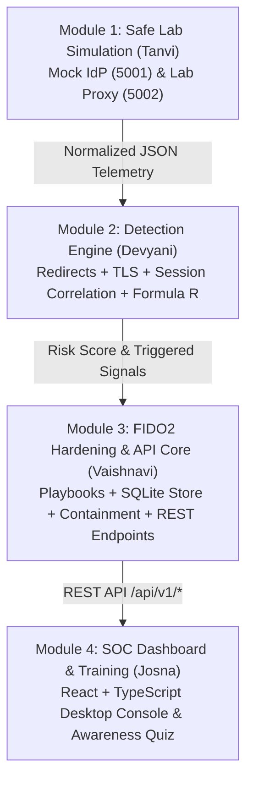

# AiTM Sentinel: Defensive AiTM Phishing Detection & Response Platform

A comprehensive cybersecurity research and detection framework designed to analyze, detect, and mitigate **Adversary-in-the-Middle (AiTM)** phishing attacks. Developed for the **DeepCytes Cyber Labs UK Fellowship (Track H: Adversary-in-the-Middle Phishing)**.

This platform combines safe attack simulation, transport-layer certificate inspection, redirect sequence heuristics, temporal session correlation, explainable mathematical risk scoring ($R = 30D + 20C + 25S + 15E + 10A$), and FIDO2/passkey origin-binding defense with an enterprise SOC command center.

---

## Table of Contents
1. [What is AiTM Phishing?](#what-is-aitm-phishing)
2. [Why Traditional Defenses Fail](#why-traditional-defenses-fail)
3. [Project Architecture & Four-Module Division](#project-architecture--four-module-division)
4. [Explainable Risk-Scoring Formula](#explainable-risk-scoring-formula)
5. [The 8-Screen SOC Architecture](#the-8-screen-soc-architecture)
6. [Interactive Detection Lab Scenarios](#interactive-detection-lab-scenarios)
7. [FIDO2 & Cryptographic Token Protection](#fido2--cryptographic-token-protection)
8. [Installation & Quick Start](#installation--quick-start)
9. [Running Automated Tests](#running-automated-tests)
10. [REST API Reference](#rest-api-reference)
11. [Ethical & Safe Lab Boundaries](#ethical--safe-lab-boundaries)
12. [Team & Contributors](#team--contributors)

---

## What is AiTM Phishing?

Traditional phishing attacks create a static fake login page to steal usernames and passwords. When Multi-Factor Authentication (MFA) is enabled (e.g. SMS codes or authenticator app approval), stolen passwords alone are useless to an attacker.

**Adversary-in-the-Middle (AiTM) phishing** bypasses traditional MFA by placing an automated **reverse proxy** (e.g., *Evilginx2* or *Morker*) between the user and the legitimate Identity Provider (IdP):

```
[ Victim User ] 
       │ 1. Enters credentials & approves genuine MFA
       ▼
[ Attacker Reverse Proxy ] (e.g. login.microsoftonline.corp-auth.invalid)
       │ 2. Transparently relays traffic in real time
       ▼
[ Legitimate Identity Provider ] (Microsoft / Google / Okta)
       │ 3. Issues authenticated session token/cookie
       ▼
[ Attacker Captures Token ] ──► 4. Replays token to hijack account!
```

MITRE ATT&CK identifies stolen session cookies as [T1539](https://attack.mitre.org/techniques/T1539/) and session-cookie replay as [T1550.004](https://attack.mitre.org/techniques/T1550/004/).

---

## Why Traditional Defenses Fail

| Traditional Defense | Why It Misses AiTM Reverse Proxies |
| :--- | :--- |
| **URL Blocklists** | Newly registered proxy domains are used within hours, before blocklists index them. |
| **Page Content Matching** | The reverse proxy relays the real login page; logos, branding, and CSS are 100% genuine. |
| **HTTPS Padlock Indicator** | HTTPS only proves traffic to the *displayed domain* is encrypted; attackers easily obtain free, valid SSL certificates. |
| **SMS / Mobile Push MFA** | The transparent proxy forwards the MFA challenge to the victim and the victim's approval to the real IdP. |
| **Single-Event Monitoring** | Individual login events appear legitimate without cross-domain redirect and session-device correlation. |

---

## Project Architecture & Four-Module Division

The platform is organized into four collaborative modules working as a unified pipeline:



* **Module 1 (Tanvi — `tanvi/aitm-poc`):** Lab Simulation & Input Validation. Provides the live mock IdP (`mock_idp.py` on port 5001) and transparent lab reverse proxy (`lab_proxy.py` on port 5002) demonstrating token capture safely.
* **Module 2 (Devyani — `devyani/detection`):** Detection & Multi-Signal Scoring Engine. Implements the redirect chain topology analyzer, `TLSAnalyzer`, and temporal `SessionTracker`.
* **Module 3 (Vaishnavi — `vaishnavi/hardening`):** FIDO2/Passkey Defense, Hardening & API Core. Implements the 11-factor authentication resistance matrix, CISA/NIST hardening checklist, persistent SQLite store (`data/aitm_sentinel.db`), defensive containment endpoints, and the full REST API server.
* **Module 4 (Josna — `josna/dashboard-training`):** Web SOC Dashboard & User Awareness Training Frontend. Consumes the backend API to present the triage dashboard and certification quiz in React + TypeScript.

---

## Explainable Risk-Scoring Formula

To eliminate black-box opacity, the platform implements the exact explainable scoring model specified by the DeepCytes Fellowship:

$$R = 30D + 20C + 25S + 15E + 10A$$

Where each variable is an explainable binary or weighted indicator:
* **$D$ (Weight 30):** Unexpected identity-provider destination domain or hostname mismatch.
* **$C$ (Weight 20):** Suspicious certificate or TLS anomaly (self-signed, untrusted root, expired, or SNI mismatch).
* **$S$ (Weight 25):** Session-replay indicator (token reuse across incompatible contexts or post-revocation access).
* **$E$ (Weight 15):** Suspicious redirect sequence (cyclic hops, proxy injection, or hop count $> 3$).
* **$A$ (Weight 10):** Authentication-context anomaly (rapid IP transition $< 60\text{s}$ or OS platform divergence).

* **Threshold:** Score $\ge 60$ triggers an automated **HIGH RISK** alert and recommended session containment.

---

## The 8-Screen SOC Architecture

The web platform provides a comprehensive desktop security operations workflow:

1. **Screen 01: Command Centre (`/api/v1/dashboard/summary`):** High-level SOC metrics, active alerts, events processed, threat breakdown radar, and recent incidents table.
2. **Screen 02: Detection Lab (`/api/v1/lab/*`):** Interactive scenario execution runner with hop-by-hop flow visualizer, live formula chip scoring, and threat model verification.
3. **Screen 03: Event Explorer (`/api/v1/events`):** Filterable security event stream with severity badges, search filtering, and raw JSON telemetry inspector.
4. **Screen 04: Incident Investigation (`/api/v1/incidents/*`):** Chronological attack stage timelines, triage status updates, and one-click Markdown **Forensic Incident Dossier Export**.
5. **Screen 05: Session Management & Containment (`/api/v1/sessions/*`):** Active synthetic sessions table, one-click **"Revoke Session"** containment, and **"Test Access"** button proving HTTP 401 Unauthorized access rejection.
6. **Screen 06: Detection Rules (`/api/v1/rules`):** Configurable thresholds for rules `DET-001` through `DET-005`.
7. **Screen 07: Security Hardening (`/api/v1/hardening/checklist`):** CISA and NIST SP 800-63B hardening checklist with status toggles (`Verified`, `In progress`, `Not assessed`).
8. **Screen 08: User Training & Quiz (`/api/v1/training/*`):** 3 educational lessons on AiTM mechanics and an interactive 8-question certification quiz with automated scoring and feedback.

---

## Interactive Detection Lab Scenarios

The Detection Lab provides 6 reproducible test scenarios:

| Scenario ID | Title | Threat Category | Expected Outcome |
| :--- | :--- | :--- | :--- |
| `SCN-001` | Normal Authentication | Baseline | **LOW RISK** (Score < 30) — Normal legitimate SSO |
| `SCN-002` | Unexpected Login Domain | Domain Anomaly | **HIGH RISK** (Score $\ge 50$) — Lookalike proxy with SAN mismatch |
| `SCN-003` | Suspicious Redirect Chain | Redirect Chain | **MEDIUM RISK** (Score $\ge 40$) — Cyclic proxy insertion loop |
| `SCN-004` | Synthetic Session Replay | Token Hijacking | **HIGH RISK** (Score $\ge 60$) — Replay from external Linux context |
| `SCN-005` | Access After Session Revocation | Defensive Containment | **CRITICAL / BLOCKED** — Access denied with **HTTP 401** |
| `SCN-006` | Legitimate Network Change | False-Positive Test | **LOW RISK** — Benign VPN/cellular roaming suppressed |

---

## FIDO2 & Cryptographic Token Protection

### Why Passkeys (FIDO2 / WebAuthn) Cannot Be Phished
FIDO2 passkeys rely on **cryptographic origin binding**. During authentication, the browser cryptographically binds the signature to the true domain in the address bar (`rpId`):
* If an attacker reverse-proxies through `evil-login.net`, the browser signs `evil-login.net` into `clientDataJSON.origin`.
* When the proxy forwards the signature to `login.microsoftonline.com`, the Microsoft Identity Provider checks the origin hash.
* **The signature is cryptographically invalid for Microsoft's domain and is immediately rejected.**

### Cryptographic Token Protection (RFC 9449 DPoP)
Demonstrating Demonstrating Proof-of-Possession (DPoP) binding: Even if a proxy intercepts an OAuth 2.0 access token, the token is cryptographically bound to the client workstation's private key. Replaying the stolen token from an attacker box fails token-binding validation.

---

## Installation & Quick Start

### 1. Prerequisites
* Python 3.10+
* Git

### 2. Clone and Setup
```bash
git clone https://github.com/tanviupg/AiTM-Phishing-Defense.git
cd AiTM-Phishing-Defense
git checkout vaishnavi/hardening
pip install -r requirements.txt  # or: pip install fastapi uvicorn pytest
```

### 3. Launch the Platform
```bash
python module3_hardening/api.py
```
Open your browser:
* **Interactive SOC Command Center:** `http://127.0.0.1:8000/`
* **Swagger OpenAPI Documentation:** `http://127.0.0.1:8000/docs`

---

## Running Automated Tests

Run the complete test suite across all modules:
```bash
python -m pytest
```
*Current test suite:* **136 automated tests passing in ~3.5 seconds** covering event schemas, reverse-proxy interception, multi-signal detection, temporal correlation, FIDO2 proofs, and the 8-screen API v2.

---

## REST API Reference

| Endpoint | Method | Screen / Purpose |
| :--- | :---: | :--- |
| `/api/defense/health` | `GET` | Health check & pipeline status |
| `/api/v1/dashboard/summary` | `GET` | Screen 01: High-level metrics & incident queues |
| `/api/v1/lab/scenarios` | `GET` | Screen 02: List 6 controlled lab scenarios |
| `/api/v1/lab/scenarios/{id}/run` | `POST` | Screen 02: Execute scenario & evaluate formula $R$ |
| `/api/v1/lab/reset` | `POST` | Screen 02: Reset lab test database to clean baseline |
| `/api/v1/events` | `GET` | Screen 03: Query normalized security event telemetry |
| `/api/v1/incidents` | `GET` | Screen 04: List security incidents |
| `/api/v1/incidents/{id}` | `GET` | Screen 04: Deep incident triage details & timeline |
| `/api/v1/incidents/{id}/export` | `GET` | Screen 04: Export Markdown Forensic Incident Dossier |
| `/api/v1/sessions` | `GET` | Screen 05: List synthetic sessions |
| `/api/v1/sessions/{id}/revoke` | `POST` | Screen 05: Revoke session token (Defensive Containment) |
| `/api/v1/sessions/{id}/test_access` | `POST` | Screen 05: Verify access is blocked (HTTP 401) |
| `/api/v1/rules` | `GET` | Screen 06: List detection rules DET-001 to DET-005 |
| `/api/v1/hardening/checklist` | `GET` | Screen 07: CISA/NIST hardening checklist items |
| `/api/v1/hardening/checklist/{id}` | `PATCH`| Screen 07: Update checklist item review status |
| `/api/v1/training/modules` | `GET` | Screen 08: Retrieve lessons and quiz questions |
| `/api/v1/training/quiz/verify` | `POST` | Screen 08: Submit and evaluate certification quiz |

---

## Ethical & Safe Lab Boundaries

* **No Real-World Attack Tooling:** This project does not deploy turnkey weaponized credential harvesting proxies against real Microsoft, Google, or Meta accounts.
* **Controlled Lab Environment:** Demonstrations run against local, isolated test endpoints (`mock_idp.py` on localhost:5001) using synthetic credentials (`alice@lab.local`) and nonfunctional sample tokens.
* **Defensive Focus:** The engineering contribution focuses entirely on telemetry correlation, explainable detection heuristics, and rapid session containment.

---

## Team & Contributors

Developed for the **DeepCytes Cyber Labs UK Fellowship**:
* **Module 1 (Lab Simulation & Reverse Proxy PoC):** Tanvi Upganlawar ([@tanviupg](https://github.com/tanviupg)) — Branch: `tanvi/aitm-poc`
* **Module 2 (Detection & Risk-Scoring Engine):** Devyani Gurgude ([@devyanigurgude](https://github.com/devyanigurgude)) — Branch: `devyani/detection`
* **Module 3 (FIDO2 Hardening & API Core):** Vaishnavi Phalke — Branch: `vaishnavi/hardening`
* **Module 4 (SOC Dashboard & User Training):** Josna — Branch: `josna/dashboard-training`
