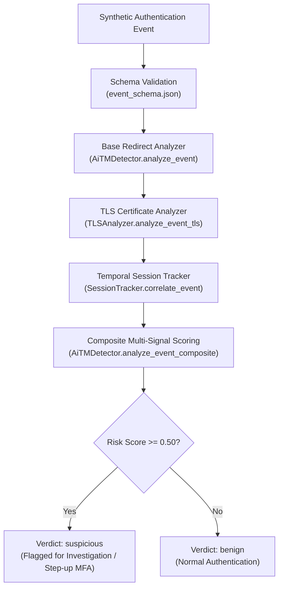
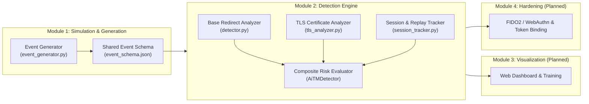

# AiTM Phishing Defense

A comprehensive research and detection framework designed to analyze, detect, and mitigate **Adversary-in-the-Middle (AiTM)** phishing attacks. This project combines synthetic attack simulation, transport-layer certificate inspection, redirect sequence heuristics, and temporal session correlation to identify reverse-proxy phishing attempts before session tokens can be exploited.

---

## Table of Contents
1. [What is AiTM Phishing?](#what-is-aitm-phishing)
2. [Why This Project is Needed](#why-this-project-is-needed)
3. [Project Objectives](#project-objectives)
4. [How the System Works](#how-the-system-works)
5. [System Architecture](#system-architecture)
6. [Module Overview](#module-overview)
7. [Technologies and Tools](#technologies-and-tools)
8. [Repository Structure](#repository-structure)
9. [Key Implemented Features](#key-implemented-features)
10. [Detection Signals & Scoring Model](#detection-signals--scoring-model)
11. [Installation and Prerequisites](#installation-and-prerequisites)
12. [How to Run and Verify](#how-to-run-and-verify)
13. [Synthetic Benchmark Results](#synthetic-benchmark-results)
14. [Example Usage](#example-usage)
15. [Current Status & Limitations](#current-status--limitations)
16. [Security and Ethical Considerations](#security-and-ethical-considerations)
17. [Future Improvements](#future-improvements)
18. [Contributors](#contributors)

---

## What is AiTM Phishing?

Traditional phishing attacks create a fake login page that mimics a legitimate service. When a user enters their username and password, the attacker captures them. However, if the service requires **Multi-Factor Authentication (MFA)**—such as a one-time passcode (OTP) sent via SMS or an authenticator app—traditional phishing fails because the attacker does not have the transient passcode.

**Adversary-in-the-Middle (AiTM) phishing** bypasses traditional MFA by placing a transparent **reverse proxy** (such as tools like Evilginx or Modlishka) between the user and the real Identity Provider (IdP):

1. **Proxy Insertion**: The victim clicks a phishing link and connects to an attacker-controlled proxy server that visually mirrors the real login page.
2. **Relayed Authentication**: The proxy forwards the victim's credentials and MFA requests in real time to the legitimate authentication service.
3. **Session Hijacking**: Once the victim completes the real MFA challenge, the authentic service issues authenticated **session cookies or bearer tokens**.
4. **Token Theft & Replay**: The reverse proxy intercepts these session tokens as they pass through the proxy and stores them. The attacker can then inject these stolen tokens into their own browser to access the victim's account without ever knowing the MFA passcode or needing the victim's device.

```
[ Victim User ] <==== HTTP/TLS ====> [ AiTM Proxy ] <==== HTTP/TLS ====> [ Legitimate IdP ]
                                      (Steals Session Cookie)
                                                |
                                                v
                                      [ Attacker Session ] (Replays stolen cookie)
```

---

## Why This Project is Needed

* **Traditional MFA is Vulnerable to Proxies**: Standard authentication mechanisms (passwords, SMS OTPs, email codes, and mobile push prompts) authenticate the user to the proxy, not directly to the genuine host.
* **Visibility Gap**: Identity Providers often view proxy-forwarded logins as legitimate traffic because valid credentials and valid MFA tokens were submitted.
* **Educational & Research Need**: Engineering teams and security analysts need accessible, reproducible frameworks to study proxy-based attack telemetry, evaluate multi-signal detection rules, and design resilient authentication defenses in safe lab environments without exposing real credentials.

---

## Project Objectives

1. **Simulate Attack Telemetry Safely**: Generate synthetic authentication logs representing both benign Single Sign-On (SSO) flows and malicious proxy-mediated sessions without handling real user credentials or live session cookies.
2. **Build Multi-Signal Detection**: Analyze telemetry across three distinct detection layers:
   * **HTTP Redirect Sequences**: Detect abnormal hop counts, redirect cycles, and cross-domain hops.
   * **TLS Certificate Metadata**: Inspect certificate validity, host mismatches, self-signed certificates, and Server Name Indication (SNI) agreement.
   * **Temporal Session Transitions**: Track in-flight sessions over time to spot rapid IP switches, client platform shifts, concurrent session bifurcation, and token-binding telemetry failures.
3. **Provide Explainable Risk Scoring**: Compute a transparent, additive risk score capped at `1.00`, providing granular indicators rather than opaque black-box verdicts.
4. **Benchmark Detection Accuracy**: Validate detection rules against standardized benchmark suites, measuring precision, recall, and false-positive rates.

---

## How the System Works

The detection framework processes authentication events through a multi-stage evaluation pipeline:



1. **Event Ingestion**: An authentication event is received as a JSON object containing session identifiers, timestamps, redirect chains, IP addresses, device context, and optional TLS/token metadata.
2. **Redirect Sequence Analysis**: The system evaluates the sequence of hostnames traversed during authentication. Benign SSO typically follows clean patterns (e.g., `Service Provider -> Identity Provider -> Service Provider`), while AiTM proxies often introduce redirect cycles, unexpected hops, or cross-domain transitions.
3. **Transport-Layer Inspection**: The engine examines transport certificate telemetry. Phishing proxies often use improperly configured certificates, self-signed certificates, or certificates whose Subject Alternative Names (SAN) do not match the expected authentication domain.
4. **Session Context Correlation**: The session tracker maintains an in-memory chronological record of events for each session ID. It checks for sudden network shifts, platform discrepancies, rapid multi-IP alternation within tight time windows, or cryptographic token-binding failures.
5. **Additive Risk Calculation**: Detected indicators contribute predefined weights to an uncalibrated composite risk score. If the cumulative score reaches or exceeds `0.50`, the session is classified as `suspicious`.

---

## System Architecture

The project is structured into four functional modules:



---

## Module Overview

| Module | Name | Purpose | Current Status | Primary Branch |
|---|---|---|---|---|
| **Module 1** | **AiTM Lab Simulation & Event Generator** | Generates synthetic authentication security events adhering to a shared schema for safe lab evaluation. | Implemented | `origin/tanvi/aitm-poc` |
| **Module 2** | **Multi-Signal AiTM Detection Engine** | Evaluates redirect sequences, TLS certificates, and temporal session transitions with an additive scoring model. | Implemented & Verified | `devyani/detection` |
| **Module 3** | **Detection Dashboard & Training** | Interactive web dashboard to visualize detected attacks and provide awareness training. | In Development | `origin/josna/dashboard-training` |
| **Module 4** | **Authentication Hardening** | Implement phishing-resistant authentication policies (FIDO2 / WebAuthn) and cryptographic token binding. | In Development | `origin/vaishnavi/hardening` |

---

## Technologies and Tools

* **Programming Language**: Python 3.10+
* **External Dependencies**: **None** (Built exclusively with standard Python libraries: `dataclasses`, `datetime`, `json`, `pathlib`, `urllib.parse`, `bisect`, `re`, `unittest`).
* **Testing Framework**: Python standard `unittest` module.
* **Evaluation Framework**: Custom deterministic benchmark runners (`evaluate.py`, `evaluate_v2.py`).
* **Data Interchange**: Standard JSON schema (`event_schema.json`).

---

## Repository Structure

```
AiTM-Phishing-Defense/
├── README.md                           # Project documentation and usage guide
│
├── integration/                        # Shared integration contracts and test runners
│   ├── event_schema.json               # JSON schema defining required and optional event fields
│   ├── run_pipeline.py                 # Pipeline runner validating events against the schema
│   └── test_run_pipeline.py            # Unit tests for the integration pipeline runner
│
├── module1_aitm_poc/                   # Module 1: Synthetic simulation & event generation
│   ├── README.md                       # Module 1 documentation
│   ├── event_generator.py              # Generates synthetic benign and suspicious login events
│   ├── events/
│   │   └── sample_events.json          # Sample output events generated by Module 1
│   └── tests/
│       └── test_event_generator.py     # Unit tests verifying generated event schema compliance
│
└── module2_detection/                  # Module 2: Detection engine and benchmark suites
    ├── detector.py                     # Base redirect analyzer and composite multi-signal detector
    ├── tls_analyzer.py                 # Transport-layer certificate and SNI inspector
    ├── session_tracker.py              # In-memory chronological session correlation tracker
    ├── evaluate.py                     # Benchmark v1 runner (16 redirect-based scenarios)
    ├── evaluate_v2.py                  # Benchmark v2 runner (24 multi-signal composite scenarios)
    └── tests/                          # Module 2 automated test suite (96 tests)
        ├── test_detector.py            # Tests for base redirect heuristics and schema compliance
        ├── test_tls.py                 # Tests for TLS certificate and hostname validation
        ├── test_temporal.py            # Tests for temporal tracking, replay, and out-of-order events
        └── test_composite.py           # Tests for composite multi-signal scoring and edge cases
```

---

## Key Implemented Features

### 1. Base Redirect Sequence Analysis (`detector.py`)
* **Cycle Detection**: Detects circular redirect loops indicative of reverse proxies intercepting and re-routing authentication flows.
* **Hop Count Thresholds**: Flags redirect chains exceeding normal SSO patterns (> 3 hops).
* **Transition Complexity**: Calculates the number of distinct organizational domains (eTLD+1) traversed during authentication.
* **Telemetry Divergence**: Detects mismatches between client-reported redirect counts and the actual observed redirect chain length.

### 2. Transport & Certificate Telemetry Inspection (`tls_analyzer.py`)
* **Hostname Validation**: Matches observed authentication hostnames against certificate Common Names (CN) and Subject Alternative Names (SAN).
* **Single-Level Wildcard Matching**: Accurately enforces RFC 6125 wildcard matching rules (e.g., `*.example.com` matches `auth.example.com`, but correctly rejects multi-level subdomains like `deep.sub.example.com`).
* **Certificate Validity Window**: Verifies that authentication timestamps fall within the certificate's `not_before` and `not_after` boundaries (supporting both ISO-8601 strings and numeric Unix epochs).
* **Self-Signed Certificate Detection**: Identifies self-signed or untrusted root certificates used in unauthorized proxy setups.
* **SNI Host Agreement**: Validates agreement between client-provided Server Name Indication (SNI) and the negotiated certificate subject.

### 3. Chronological Session & Replay Correlation (`session_tracker.py`)
* **Session Isolation**: Tracks event history independently per `session_id`.
* **Out-of-Order Event Handling**: Uses binary search (`bisect`) to insert events chronologically by timestamp, correctly comparing out-of-order arrivals against their genuine chronological predecessor.
* **Concurrent Session Bifurcation**: Detects token replay patterns where two distinct IP addresses alternate within an active session ($IP_1 \to IP_2 \to IP_1 \to IP_2$) across 4 chronological events within a 120-second window.
* **Network & Platform Shifts**: Flags transitions from residential or corporate ASNs to datacenter hosting ASNs, as well as mid-session operating system or TLS client fingerprint shifts.
* **Token Binding Failure Correlation**: Detects cryptographic proof-of-possession token binding failures (`failed`, `key_mismatch`), even when event timestamps are missing or unparseable.

---

## Detection Signals & Scoring Model

### Heuristic Scoring Principles
* **Uncalibrated Triage Score**: Scores range from `0.00` to `1.00` (capped at `1.00`). This is a heuristic risk indicator for triage, not an empirical statistical probability.
* **Verdict Threshold**: An event with `risk_score >= 0.50` produces a verdict of `"suspicious"`. Scores below `0.50` produce `"benign"`.
* **No Single-Indicator False Positives**: Individual benign changes (such as mobile IP roaming or device upgrades) carry weights below `0.50` so that an isolated transition does not trigger a false-positive alarm without corroborating evidence.
* **Subsystem Namespacing**: Indicators use explicit prefixes (`base:`, `tls:`, `session:`) for full explainability.

### Signal Weights and Rules

| Subsystem | Indicator | Weight | Condition |
|---|---|:---:|---|
| **Base Redirects** | `base:SUSPICIOUS_REDIRECT_CYCLE` | `+0.35` | Cyclic redirect loop with $\ge 3$ intermediary hosts |
| | `base:EXCESSIVE_REDIRECT_COUNT` | `+0.30` | Redirect count $> 3$ hops outside standard SSO |
| | `base:REPEATED_REDIRECT_HOST` | `+0.25` | Repeated host outside legitimate SSO pattern |
| | `base:TLS_ANOMALY` | `+0.25` | Client sensor reports transport-layer anomaly flag |
| | `base:HIGH_TRANSITION_COMPLEXITY` | `+0.20` | Traversal of $\ge 3$ distinct organizational domains |
| | `base:ELEVATED_REDIRECT_COUNT` | `+0.15` | Exactly 3 redirect hops outside canonical pattern |
| | `base:REDIRECT_TELEMETRY_DIVERGENCE` | `+0.15` | Reported count disagrees with observed chain length |
| **TLS Transport** | `tls:CERT_HOSTNAME_MISMATCH` | `+0.30` | Certificate SAN/CN does not match target host |
| | `tls:UNTRUSTED_AUTH_HOST` | `+0.30` | Target host is not present in expected IdP allowlist |
| | `tls:UNTRUSTED_SELF_SIGNED_CERT` | `+0.20` | Certificate is self-signed or from an untrusted root |
| | `tls:CERT_EXPIRED` / `NOT_YET_VALID` | `+0.15` | Timestamp falls outside certificate validity window |
| | `tls:SNI_HOST_MISMATCH` | `+0.15` | Client SNI hostname disagrees with negotiated certificate |
| **Session Tracking** | `session:TOKEN_BINDING_FAILURE` | `+0.35` | Token binding status reports `failed` or `key_mismatch` |
| | `session:SUSPICIOUS_CONTEXT_MISMATCH` | `+0.30` | Device identifier mismatch accompanied by rapid IP change |
| | `session:CONCURRENT_SESSION_BIFURCATION` | `+0.25` | Two alternating IPs across 4 events within $\le 120.0\,\text{s}$ |
| | `session:CLIENT_PLATFORM_DIVERGENCE` | `+0.25` | Operating system platform or TLS fingerprint shifts |
| | `session:DATACENTER_SOURCE_TRANSITION` | `+0.20` | Network origin transitions to a datacenter ASN |
| | `session:DEVICE_CONTEXT_CHANGED` | `+0.15` | Device ID changes within active session (same IP) |
| | `session:RAPID_SOURCE_IP_CHANGE` | `+0.10` | Source IP changes within $< 60.0\,\text{s}$ on same device |

---

## Installation and Prerequisites

### Prerequisites
* **Python 3.10** or higher installed on your system.
* **Git** for version control.

### Setup Instructions
1. Clone the repository:
   ```bash
   git clone https://github.com/tanviupg/AiTM-Phishing-Defense.git
   cd AiTM-Phishing-Defense
   ```
2. Verify Python installation:
   ```bash
   python --version
   ```
3. No virtual environment or `pip install` steps are required—the detection engine and test suites run entirely on Python's built-in standard library.

---

## How to Run and Verify

### 1. Run the Full Unit Test Suite (96 Tests)
Executes all unit tests covering base redirect heuristics, TLS certificate parsing, chronological session tracking, out-of-order handling, and composite edge cases:
```powershell
python -m unittest discover -s module2_detection/tests -p "test_*.py"
```
*Expected Output*: `Ran 96 tests in ...s - OK`

### 2. Run Benchmark v1 (Redirect Heuristics Evaluation)
Evaluates base redirect detection across 16 synthetic scenarios:
```powershell
python .\module2_detection\evaluate.py
```

### 3. Run Benchmark v2 (Multi-Signal Composite Evaluation)
Compares the base redirect detector against the multi-signal composite detector across 24 complex scenarios:
```powershell
python .\module2_detection\evaluate_v2.py
```

### 4. Run Module 1 Event Generator & Integration Pipeline
*(When working on the integration or Module 1 branch)*
```powershell
# Generate sample events
python .\module1_aitm_poc\event_generator.py

# Test the event generator
python -m unittest discover -s .\module1_aitm_poc\tests -v

# Run the integration pipeline validator
python .\integration\run_pipeline.py
```

---

## Synthetic Benchmark Results

The detection engine has been evaluated against standardized synthetic benchmarks designed to reflect common benign authentication patterns alongside realistic AiTM proxy techniques.

### Benchmark v1: Redirect-Engine Baseline (16 Scenarios)
* **Dataset**: 16 handcrafted synthetic authentication events (8 benign, 8 suspicious).
* **Test Focus**: Direct logins, canonical SSO redirects, cyclic proxy loops, excessive hop counts, and reported TLS anomaly flags.

| Metric | Result | Interpretation |
|---|:---:|---|
| **Precision** | `1.0000` (8/8) | Zero benign events incorrectly flagged |
| **Recall** | `1.0000` (8/8) | All 8 redirect anomalies correctly detected |
| **F1-Score** | `1.0000` | Perfect balance on redirect-only test set |
| **False Positive Rate** | `0.0000` | 0 false alarms across 8 benign controls |

### Benchmark v2: Multi-Signal Composite Engine (24 Scenarios)
* **Dataset**: 24 synthetic scenarios combining redirect chains, transport certificates, and temporal session transitions (12 benign, 12 suspicious).
* **Test Focus**: Benign mobile-to-Wi-Fi handovers, CDN host aliasing, expired certificates, SNI mismatches, datacenter ASN transitions, concurrent IP bifurcation, and token-binding failures.

| Engine | Detected / Total | Precision | Recall | F1-Score | False Positives |
|---|:---:|:---:|:---:|:---:|:---:|
| **Base Redirect Detector** | 8 / 12 | `1.0000` | `0.6667` | `0.8000` | 0 (TN: 12/12) |
| **Composite Multi-Signal Detector** | 10 / 12 | `1.0000` | `0.8333` | `0.9091` | 0 (TN: 12/12) |

> **Evaluation Note**: These benchmarks measure deterministic rule performance against controlled synthetic test vectors in a laboratory environment. They demonstrate engine correctness and signal synergy, but do not represent statistical performance on unconstrained real-world network traffic.

---

## Example Usage

Here is a minimal Python example demonstrating how to instantiate the detector and analyze an authentication event:

```python
from module2_detection.detector import AiTMDetector
from module2_detection.session_tracker import SessionTracker
from module2_detection.tls_analyzer import TLSAnalyzer

# Initialize detector with session and TLS sub-analyzers
session_tracker = SessionTracker()
tls_analyzer = TLSAnalyzer()
detector = AiTMDetector(session_tracker=session_tracker, tls_analyzer=tls_analyzer)

# Sample authentication event with suspicious proxy redirect and self-signed certificate
event = {
    "session_id": "sess-demo-001",
    "timestamp": "2026-10-19T10:00:00Z",
    "source_ip": "198.51.100.25",
    "device_id": "dev-laptop-01",
    "redirect_count": 3,
    "redirect_chain": [
        "login.corporate-portal.com",
        "proxy.evil-mirror.net",
        "login.corporate-portal.com"
    ],
    "certificate_telemetry": {
        "subject_cn": "proxy.evil-mirror.net",
        "sans": ["proxy.evil-mirror.net"],
        "is_self_signed": True,
        "not_before": "2026-01-01T00:00:00Z",
        "not_after": "2027-01-01T00:00:00Z"
    }
}

# Run composite analysis
result = detector.analyze_event_composite(event)

print(f"Risk Score: {result['risk_score']:.2f}")
print(f"Verdict:    {result['verdict']}")
print(f"Indicators: {result['indicators']}")
```

**Expected Output**:
```text
Risk Score: 0.80
Verdict:    suspicious
Indicators: ['base:SUSPICIOUS_REDIRECT_CYCLE', 'base:REPEATED_REDIRECT_HOST', 'tls:UNTRUSTED_AUTH_HOST', 'tls:UNTRUSTED_SELF_SIGNED_CERT']
```

---

## Current Status & Limitations

### Current Status
* **Module 1 (Event Simulation)**: Functional and tested. Produces valid synthetic events according to `event_schema.json`.
* **Module 2 (Detection Engine)**: Fully implemented and verified. 96 unit tests passing; benchmark evaluation suites v1 and v2 operational.
* **Module 3 (Dashboard)** & **Module 4 (Hardening)**: In active development on dedicated branches.

### Known Limitations
1. **Synthetic Data Only**: All testing and evaluation use synthetic lab fixtures. The project does not currently capture live network packets or hook directly into production web browsers.
2. **Ephemeral In-Memory State**: `SessionTracker` stores active session history in local Python process memory. If the application restarts, session tracking state is cleared. Distributed persistence (e.g., Redis) is planned for future iterations.
3. **Heuristic Triage Indicator**: The composite risk score is an uncalibrated heuristic triage value, not a formal Bayesian probability of compromise.
4. **Network Transitions Require Corroboration**: Legitimate user actions (such as toggling a VPN, switching from Wi-Fi to cellular, or browser updates) can cause IP or platform changes. The engine intentionally treats single context transitions as non-suspicious unless corroborated by additional risk signals.

---

## Security and Ethical Considerations

* **Defensive Purpose Only**: This software is designed exclusively for educational, research, and defensive evaluation purposes. It helps organizations understand how reverse-proxy attacks function and how to detect them.
* **Zero Credential Exposure**: The framework processes only structural telemetry (timestamps, IP addresses, anonymized device identifiers, domain names, and certificate metadata). It **never** captures, handles, stores, or logs passwords, session tokens, authentication cookies, or private keys.
* **Synthetic Identifiers**: All sample datasets and automated tests use RFC-reserved IP addresses (such as `192.0.2.0/24`, `198.51.100.0/24`) and synthetic test domains (`example.com`, `example.org`) to prevent unintentional impact on real infrastructure.

---

## Future Improvements

* [ ] **Distributed Session Storage**: Replace in-memory session dictionaries with a Redis backend to support multi-worker, horizontally scalable deployments.
* [ ] **Live Telemetry Ingestion**: Build lightweight edge plugins (e.g., Cloudflare Workers, Envoy / Nginx filters) to stream real HTTP redirect and TLS telemetry into the detection engine.
* [ ] **Phishing-Resistant MFA Integration (Module 4)**: Implement server-side verification of FIDO2 / WebAuthn passkeys, which cryptographically bind authentication credentials to the browser's origin and completely prevent proxy replay.
* [ ] **Web Monitoring Dashboard (Module 3)**: Develop an administrative web interface to visualize in-flight session anomalies and triage flagged alerts.
* [ ] **Adaptive Anomaly Weighting**: Introduce contextual baseline learning (e.g., user-specific travel profiles) to fine-tune risk weights dynamically.

---

## Contributors

This project is developed as an academic engineering research project by third-year engineering students.

### Module 2 – AiTM Detection Engine
* **Devyani Gurgude** ([@devyanigurgude](https://github.com/devyanigurgude))
  * Designed and implemented the composite multi-signal detection architecture (`AiTMDetector.analyze_event_composite`).
  * Built the transport-layer TLS certificate inspector (`TLSAnalyzer`) with RFC 6125 wildcard matching and certificate validity checks.
  * Developed the chronological `SessionTracker` with binary-search out-of-order event insertion, deterministic timestamp comparison, and session isolation.
  * Implemented session replay and token anomaly indicators, including concurrent session bifurcation (120s window), datacenter ASN transitions, client platform divergence, and token-binding failure correlation.
  * Authored the automated unit test suite (96 tests across 4 test modules) and synthetic benchmark suites (`evaluate.py`, `evaluate_v2.py`).

### Module 1 – AiTM Lab Simulation & Event Generator
* **Tanvi Upganlawar** ([@tanviupg](https://github.com/tanviupg))
  * Initial project setup, repository scaffolding, and project coordination.
  * Designed the synthetic authentication event generator (`event_generator.py`) and schema validation pipeline.
  * Authored the shared integration schema contract (`integration/event_schema.json`) and pipeline runner (`integration/run_pipeline.py`).

### Collaborating Modules (In Development)
* **Module 3 – Detection Dashboard & Training**: **Josna** (Development branch: `origin/josna/dashboard-training`) — Real-time event visualization and user security awareness training.
* **Module 4 – Authentication Hardening**: **Vaishnavi** (Development branch: `origin/vaishnavi/hardening`) — Phishing-resistant authentication architecture, FIDO2/WebAuthn integration, and cryptographic token binding enforcement.

A comprehensive research and detection framework designed to analyze, detect, and mitigate **Adversary-in-the-Middle (AiTM)** phishing attacks. This project combines synthetic attack simulation, transport-layer certificate inspection, redirect sequence heuristics, and temporal session correlation to identify reverse-proxy phishing attempts before session tokens can be exploited.

---

## Table of Contents
1. [What is AiTM Phishing?](#what-is-aitm-phishing)
2. [Why This Project is Needed](#why-this-project-is-needed)
3. [Project Objectives](#project-objectives)
4. [How the System Works](#how-the-system-works)
5. [System Architecture](#system-architecture)
6. [Module Overview](#module-overview)
7. [Technologies and Tools](#technologies-and-tools)
8. [Repository Structure](#repository-structure)
9. [Key Implemented Features](#key-implemented-features)
10. [Detection Signals & Scoring Model](#detection-signals--scoring-model)
11. [Installation and Prerequisites](#installation-and-prerequisites)
12. [How to Run and Verify](#how-to-run-and-verify)
13. [Synthetic Benchmark Results](#synthetic-benchmark-results)
14. [Example Usage](#example-usage)
15. [Current Status & Limitations](#current-status--limitations)
16. [Security and Ethical Considerations](#security-and-ethical-considerations)
17. [Future Improvements](#future-improvements)
18. [Contributors](#contributors)

---

## What is AiTM Phishing?

Traditional phishing attacks create a fake login page that mimics a legitimate service. When a user enters their username and password, the attacker captures them. However, if the service requires **Multi-Factor Authentication (MFA)**—such as a one-time passcode (OTP) sent via SMS or an authenticator app—traditional phishing fails because the attacker does not have the transient passcode.

**Adversary-in-the-Middle (AiTM) phishing** bypasses traditional MFA by placing a transparent **reverse proxy** (such as tools like Evilginx or Modlishka) between the user and the real Identity Provider (IdP):

1. **Proxy Insertion**: The victim clicks a phishing link and connects to an attacker-controlled proxy server that visually mirrors the real login page.
2. **Relayed Authentication**: The proxy forwards the victim's credentials and MFA requests in real time to the legitimate authentication service.
3. **Session Hijacking**: Once the victim completes the real MFA challenge, the authentic service issues authenticated **session cookies or bearer tokens**.
4. **Token Theft & Replay**: The reverse proxy intercepts these session tokens as they pass through the proxy and stores them. The attacker can then inject these stolen tokens into their own browser to access the victim's account without ever knowing the MFA passcode or needing the victim's device.

```
[ Victim User ] <==== HTTP/TLS ====> [ AiTM Proxy ] <==== HTTP/TLS ====> [ Legitimate IdP ]
                                      (Steals Session Cookie)
                                                |
                                                v
                                      [ Attacker Session ] (Replays stolen cookie)
```

---

## Why This Project is Needed

* **Traditional MFA is Vulnerable to Proxies**: Standard authentication mechanisms (passwords, SMS OTPs, email codes, and mobile push prompts) authenticate the user to the proxy, not directly to the genuine host.
* **Visibility Gap**: Identity Providers often view proxy-forwarded logins as legitimate traffic because valid credentials and valid MFA tokens were submitted.
* **Educational & Research Need**: Engineering teams and security analysts need accessible, reproducible frameworks to study proxy-based attack telemetry, evaluate multi-signal detection rules, and design resilient authentication defenses in safe lab environments without exposing real credentials.

---

## Project Objectives

1. **Simulate Attack Telemetry Safely**: Generate synthetic authentication logs representing both benign Single Sign-On (SSO) flows and malicious proxy-mediated sessions without handling real user credentials or live session cookies.
2. **Build Multi-Signal Detection**: Analyze telemetry across three distinct detection layers:
   * **HTTP Redirect Sequences**: Detect abnormal hop counts, redirect cycles, and cross-domain hops.
   * **TLS Certificate Metadata**: Inspect certificate validity, host mismatches, self-signed certificates, and Server Name Indication (SNI) agreement.
   * **Temporal Session Transitions**: Track in-flight sessions over time to spot rapid IP switches, client platform shifts, concurrent session bifurcation, and token-binding telemetry failures.
3. **Provide Explainable Risk Scoring**: Compute a transparent, additive risk score capped at `1.00`, providing granular indicators rather than opaque black-box verdicts.
4. **Benchmark Detection Accuracy**: Validate detection rules against standardized benchmark suites, measuring precision, recall, and false-positive rates.

---

## How the System Works

The detection framework processes authentication events through a multi-stage evaluation pipeline:


1. **Event Ingestion**: An authentication event is received as a JSON object containing session identifiers, timestamps, redirect chains, IP addresses, device context, and optional TLS/token metadata.
2. **Redirect Sequence Analysis**: The system evaluates the sequence of hostnames traversed during authentication. Benign SSO typically follows clean patterns (e.g., `Service Provider -> Identity Provider -> Service Provider`), while AiTM proxies often introduce redirect cycles, unexpected hops, or cross-domain transitions.
3. **Transport-Layer Inspection**: The engine examines transport certificate telemetry. Phishing proxies often use improperly configured certificates, self-signed certificates, or certificates whose Subject Alternative Names (SAN) do not match the expected authentication domain.
4. **Session Context Correlation**: The session tracker maintains an in-memory chronological record of events for each session ID. It checks for sudden network shifts, platform discrepancies, rapid multi-IP alternation within tight time windows, or cryptographic token-binding failures.
5. **Additive Risk Calculation**: Detected indicators contribute predefined weights to an uncalibrated composite risk score. If the cumulative score reaches or exceeds `0.50`, the session is classified as `suspicious`.

---

## System Architecture

The project is structured into four functional modules:


---

## Module Overview

| Module | Name | Purpose | Current Status | Primary Branch |
|---|---|---|---|---|
| **Module 1** | **AiTM Lab Simulation & Event Generator** | Generates synthetic authentication security events adhering to a shared schema for safe lab evaluation. | Implemented | `origin/tanvi/aitm-poc` |
| **Module 2** | **Multi-Signal AiTM Detection Engine** | Evaluates redirect sequences, TLS certificates, and temporal session transitions with an additive scoring model. | Implemented & Verified | `devyani/detection` |
| **Module 3** | **Detection Dashboard & Training** | Interactive web dashboard to visualize detected attacks and provide awareness training. | In Development | `origin/josna/dashboard-training` |
| **Module 4** | **Authentication Hardening** | Implement phishing-resistant authentication policies (FIDO2 / WebAuthn) and cryptographic token binding. | In Development | `origin/vaishnavi/hardening` |

---

## Technologies and Tools

* **Programming Language**: Python 3.10+
* **External Dependencies**: **None** (Built exclusively with standard Python libraries: `dataclasses`, `datetime`, `json`, `pathlib`, `urllib.parse`, `bisect`, `re`, `unittest`).
* **Testing Framework**: Python standard `unittest` module.
* **Evaluation Framework**: Custom deterministic benchmark runners (`evaluate.py`, `evaluate_v2.py`).
* **Data Interchange**: Standard JSON schema (`event_schema.json`).

---

## Repository Structure

```
AiTM-Phishing-Defense/
├── README.md                           # Project documentation and usage guide
│
├── integration/                        # Shared integration contracts and test runners
│   ├── event_schema.json               # JSON schema defining required and optional event fields
│   ├── run_pipeline.py                 # Pipeline runner validating events against the schema
│   └── test_run_pipeline.py            # Unit tests for the integration pipeline runner
│
├── module1_aitm_poc/                   # Module 1: Synthetic simulation & event generation
│   ├── README.md                       # Module 1 documentation
│   ├── event_generator.py              # Generates synthetic benign and suspicious login events
│   ├── events/
│   │   └── sample_events.json          # Sample output events generated by Module 1
│   └── tests/
│       └── test_event_generator.py     # Unit tests verifying generated event schema compliance
│
└── module2_detection/                  # Module 2: Detection engine and benchmark suites
    ├── detector.py                     # Base redirect analyzer and composite multi-signal detector
    ├── tls_analyzer.py                 # Transport-layer certificate and SNI inspector
    ├── session_tracker.py              # In-memory chronological session correlation tracker
    ├── evaluate.py                     # Benchmark v1 runner (16 redirect-based scenarios)
    ├── evaluate_v2.py                  # Benchmark v2 runner (24 multi-signal composite scenarios)
    └── tests/                          # Module 2 automated test suite (96 tests)
        ├── test_detector.py            # Tests for base redirect heuristics and schema compliance
        ├── test_tls.py                 # Tests for TLS certificate and hostname validation
        ├── test_temporal.py            # Tests for temporal tracking, replay, and out-of-order events
        └── test_composite.py           # Tests for composite multi-signal scoring and edge cases
```

---

## Key Implemented Features

### 1. Base Redirect Sequence Analysis (`detector.py`)
* **Cycle Detection**: Detects circular redirect loops indicative of reverse proxies intercepting and re-routing authentication flows.
* **Hop Count Thresholds**: Flags redirect chains exceeding normal SSO patterns (> 3 hops).
* **Transition Complexity**: Calculates the number of distinct organizational domains (eTLD+1) traversed during authentication.
* **Telemetry Divergence**: Detects mismatches between client-reported redirect counts and the actual observed redirect chain length.

### 2. Transport & Certificate Telemetry Inspection (`tls_analyzer.py`)
* **Hostname Validation**: Matches observed authentication hostnames against certificate Common Names (CN) and Subject Alternative Names (SAN).
* **Single-Level Wildcard Matching**: Accurately enforces RFC 6125 wildcard matching rules (e.g., `*.example.com` matches `auth.example.com`, but correctly rejects multi-level subdomains like `deep.sub.example.com`).
* **Certificate Validity Window**: Verifies that authentication timestamps fall within the certificate's `not_before` and `not_after` boundaries (supporting both ISO-8601 strings and numeric Unix epochs).
* **Self-Signed Certificate Detection**: Identifies self-signed or untrusted root certificates used in unauthorized proxy setups.
* **SNI Host Agreement**: Validates agreement between client-provided Server Name Indication (SNI) and the negotiated certificate subject.

### 3. Chronological Session & Replay Correlation (`session_tracker.py`)
* **Session Isolation**: Tracks event history independently per `session_id`.
* **Out-of-Order Event Handling**: Uses binary search (`bisect`) to insert events chronologically by timestamp, correctly comparing out-of-order arrivals against their genuine chronological predecessor.
* **Concurrent Session Bifurcation**: Detects token replay patterns where two distinct IP addresses alternate within an active session ($IP_1 \to IP_2 \to IP_1 \to IP_2$) across 4 chronological events within a 120-second window.
* **Network & Platform Shifts**: Flags transitions from residential or corporate ASNs to datacenter hosting ASNs, as well as mid-session operating system or TLS client fingerprint shifts.
* **Token Binding Failure Correlation**: Detects cryptographic proof-of-possession token binding failures (`failed`, `key_mismatch`), even when event timestamps are missing or unparseable.

---

## Detection Signals & Scoring Model

### Heuristic Scoring Principles
* **Uncalibrated Triage Score**: Scores range from `0.00` to `1.00` (capped at `1.00`). This is a heuristic risk indicator for triage, not an empirical statistical probability.
* **Verdict Threshold**: An event with `risk_score >= 0.50` produces a verdict of `"suspicious"`. Scores below `0.50` produce `"benign"`.
* **No Single-Indicator False Positives**: Individual benign changes (such as mobile IP roaming or device upgrades) carry weights below `0.50` so that an isolated transition does not trigger a false-positive alarm without corroborating evidence.
* **Subsystem Namespacing**: Indicators use explicit prefixes (`base:`, `tls:`, `session:`) for full explainability.

### Signal Weights and Rules

| Subsystem | Indicator | Weight | Condition |
|---|---|:---:|---|
| **Base Redirects** | `base:SUSPICIOUS_REDIRECT_CYCLE` | `+0.35` | Cyclic redirect loop with $\ge 3$ intermediary hosts |
| | `base:EXCESSIVE_REDIRECT_COUNT` | `+0.30` | Redirect count $> 3$ hops outside standard SSO |
| | `base:REPEATED_REDIRECT_HOST` | `+0.25` | Repeated host outside legitimate SSO pattern |
| | `base:TLS_ANOMALY` | `+0.25` | Client sensor reports transport-layer anomaly flag |
| | `base:HIGH_TRANSITION_COMPLEXITY` | `+0.20` | Traversal of $\ge 3$ distinct organizational domains |
| | `base:ELEVATED_REDIRECT_COUNT` | `+0.15` | Exactly 3 redirect hops outside canonical pattern |
| | `base:REDIRECT_TELEMETRY_DIVERGENCE` | `+0.15` | Reported count disagrees with observed chain length |
| **TLS Transport** | `tls:CERT_HOSTNAME_MISMATCH` | `+0.30` | Certificate SAN/CN does not match target host |
| | `tls:UNTRUSTED_AUTH_HOST` | `+0.30` | Target host is not present in expected IdP allowlist |
| | `tls:UNTRUSTED_SELF_SIGNED_CERT` | `+0.20` | Certificate is self-signed or from an untrusted root |
| | `tls:CERT_EXPIRED` / `NOT_YET_VALID` | `+0.15` | Timestamp falls outside certificate validity window |
| | `tls:SNI_HOST_MISMATCH` | `+0.15` | Client SNI hostname disagrees with negotiated certificate |
| **Session Tracking** | `session:TOKEN_BINDING_FAILURE` | `+0.35` | Token binding status reports `failed` or `key_mismatch` |
| | `session:SUSPICIOUS_CONTEXT_MISMATCH` | `+0.30` | Device identifier mismatch accompanied by rapid IP change |
| | `session:CONCURRENT_SESSION_BIFURCATION` | `+0.25` | Two alternating IPs across 4 events within $\le 120.0\,\text{s}$ |
| | `session:CLIENT_PLATFORM_DIVERGENCE` | `+0.25` | Operating system platform or TLS fingerprint shifts |
| | `session:DATACENTER_SOURCE_TRANSITION` | `+0.20` | Network origin transitions to a datacenter ASN |
| | `session:DEVICE_CONTEXT_CHANGED` | `+0.15` | Device ID changes within active session (same IP) |
| | `session:RAPID_SOURCE_IP_CHANGE` | `+0.10` | Source IP changes within $< 60.0\,\text{s}$ on same device |

---

## Installation and Prerequisites

### Prerequisites
* **Python 3.10** or higher installed on your system.
* **Git** for version control.

### Setup Instructions
1. Clone the repository:
   ```bash
   git clone https://github.com/tanviupg/AiTM-Phishing-Defense.git
   cd AiTM-Phishing-Defense
   ```
2. Verify Python installation:
   ```bash
   python --version
   ```
3. No virtual environment or `pip install` steps are required—the detection engine and test suites run entirely on Python's built-in standard library.

---

## How to Run and Verify

### 1. Run the Full Unit Test Suite (96 Tests)
Executes all unit tests covering base redirect heuristics, TLS certificate parsing, chronological session tracking, out-of-order handling, and composite edge cases:
```powershell
python -m unittest discover -s module2_detection/tests -p "test_*.py"
```
*Expected Output*: `Ran 96 tests in ...s - OK`

### 2. Run Benchmark v1 (Redirect Heuristics Evaluation)
Evaluates base redirect detection across 16 synthetic scenarios:
```powershell
python .\module2_detection\evaluate.py
```

### 3. Run Benchmark v2 (Multi-Signal Composite Evaluation)
Compares the base redirect detector against the multi-signal composite detector across 24 complex scenarios:
```powershell
python .\module2_detection\evaluate_v2.py
```

### 4. Run Module 1 Event Generator & Integration Pipeline
*(When working on the integration or Module 1 branch)*
```powershell
# Generate sample events
python .\module1_aitm_poc\event_generator.py

# Test the event generator
python -m unittest discover -s .\module1_aitm_poc\tests -v

# Run the integration pipeline validator
python .\integration\run_pipeline.py
```

---

## Synthetic Benchmark Results

The detection engine has been evaluated against standardized synthetic benchmarks designed to reflect common benign authentication patterns alongside realistic AiTM proxy techniques.

### Benchmark v1: Redirect-Engine Baseline (16 Scenarios)
* **Dataset**: 16 handcrafted synthetic authentication events (8 benign, 8 suspicious).
* **Test Focus**: Direct logins, canonical SSO redirects, cyclic proxy loops, excessive hop counts, and reported TLS anomaly flags.

| Metric | Result | Interpretation |
|---|:---:|---|
| **Precision** | `1.0000` (8/8) | Zero benign events incorrectly flagged |
| **Recall** | `1.0000` (8/8) | All 8 redirect anomalies correctly detected |
| **F1-Score** | `1.0000` | Perfect balance on redirect-only test set |
| **False Positive Rate** | `0.0000` | 0 false alarms across 8 benign controls |

### Benchmark v2: Multi-Signal Composite Engine (24 Scenarios)
* **Dataset**: 24 synthetic scenarios combining redirect chains, transport certificates, and temporal session transitions (12 benign, 12 suspicious).
* **Test Focus**: Benign mobile-to-Wi-Fi handovers, CDN host aliasing, expired certificates, SNI mismatches, datacenter ASN transitions, concurrent IP bifurcation, and token-binding failures.

| Engine | Detected / Total | Precision | Recall | F1-Score | False Positives |
|---|:---:|:---:|:---:|:---:|:---:|
| **Base Redirect Detector** | 8 / 12 | `1.0000` | `0.6667` | `0.8000` | 0 (TN: 12/12) |
| **Composite Multi-Signal Detector** | 10 / 12 | `1.0000` | `0.8333` | `0.9091` | 0 (TN: 12/12) |

> **Evaluation Note**: These benchmarks measure deterministic rule performance against controlled synthetic test vectors in a laboratory environment. They demonstrate engine correctness and signal synergy, but do not represent statistical performance on unconstrained real-world network traffic.

---

## Example Usage

Here is a minimal Python example demonstrating how to instantiate the detector and analyze an authentication event:

```python
from module2_detection.detector import AiTMDetector
from module2_detection.session_tracker import SessionTracker
from module2_detection.tls_analyzer import TLSAnalyzer

# Initialize detector with session and TLS sub-analyzers
session_tracker = SessionTracker()
tls_analyzer = TLSAnalyzer()
detector = AiTMDetector(session_tracker=session_tracker, tls_analyzer=tls_analyzer)

# Sample authentication event with suspicious proxy redirect and self-signed certificate
event = {
    "session_id": "sess-demo-001",
    "timestamp": "2026-10-19T10:00:00Z",
    "source_ip": "198.51.100.25",
    "device_id": "dev-laptop-01",
    "redirect_count": 3,
    "redirect_chain": [
        "login.corporate-portal.com",
        "proxy.evil-mirror.net",
        "login.corporate-portal.com"
    ],
    "certificate_telemetry": {
        "subject_cn": "proxy.evil-mirror.net",
        "sans": ["proxy.evil-mirror.net"],
        "is_self_signed": True,
        "not_before": "2026-01-01T00:00:00Z",
        "not_after": "2027-01-01T00:00:00Z"
    }
}

# Run composite analysis
result = detector.analyze_event_composite(event)

print(f"Risk Score: {result['risk_score']:.2f}")
print(f"Verdict:    {result['verdict']}")
print(f"Indicators: {result['indicators']}")
```

**Expected Output**:
```text
Risk Score: 0.80
Verdict:    suspicious
Indicators: ['base:SUSPICIOUS_REDIRECT_CYCLE', 'base:REPEATED_REDIRECT_HOST', 'tls:UNTRUSTED_AUTH_HOST', 'tls:UNTRUSTED_SELF_SIGNED_CERT']
```

---

## Current Status & Limitations

### Current Status
* **Module 1 (Event Simulation)**: Functional and tested. Produces valid synthetic events according to `event_schema.json`.
* **Module 2 (Detection Engine)**: Fully implemented and verified. 96 unit tests passing; benchmark evaluation suites v1 and v2 operational.
* **Module 3 (Dashboard)** & **Module 4 (Hardening)**: In active development on dedicated branches.

### Known Limitations
1. **Synthetic Data Only**: All testing and evaluation use synthetic lab fixtures. The project does not currently capture live network packets or hook directly into production web browsers.
2. **Ephemeral In-Memory State**: `SessionTracker` stores active session history in local Python process memory. If the application restarts, session tracking state is cleared. Distributed persistence (e.g., Redis) is planned for future iterations.
3. **Heuristic Triage Indicator**: The composite risk score is an uncalibrated heuristic triage value, not a formal Bayesian probability of compromise.
4. **Network Transitions Require Corroboration**: Legitimate user actions (such as toggling a VPN, switching from Wi-Fi to cellular, or browser updates) can cause IP or platform changes. The engine intentionally treats single context transitions as non-suspicious unless corroborated by additional risk signals.

---

## Security and Ethical Considerations

* **Defensive Purpose Only**: This software is designed exclusively for educational, research, and defensive evaluation purposes. It helps organizations understand how reverse-proxy attacks function and how to detect them.
* **Zero Credential Exposure**: The framework processes only structural telemetry (timestamps, IP addresses, anonymized device identifiers, domain names, and certificate metadata). It **never** captures, handles, stores, or logs passwords, session tokens, authentication cookies, or private keys.
* **Synthetic Identifiers**: All sample datasets and automated tests use RFC-reserved IP addresses (such as `192.0.2.0/24`, `198.51.100.0/24`) and synthetic test domains (`example.com`, `example.org`) to prevent unintentional impact on real infrastructure.

---

## Future Improvements

* [ ] **Distributed Session Storage**: Replace in-memory session dictionaries with a Redis backend to support multi-worker, horizontally scalable deployments.
* [ ] **Live Telemetry Ingestion**: Build lightweight edge plugins (e.g., Cloudflare Workers, Envoy / Nginx filters) to stream real HTTP redirect and TLS telemetry into the detection engine.
* [ ] **Phishing-Resistant MFA Integration (Module 4)**: Implement server-side verification of FIDO2 / WebAuthn passkeys, which cryptographically bind authentication credentials to the browser's origin and completely prevent proxy replay.
* [ ] **Web Monitoring Dashboard (Module 3)**: Develop an administrative web interface to visualize in-flight session anomalies and triage flagged alerts.
* [ ] **Adaptive Anomaly Weighting**: Introduce contextual baseline learning (e.g., user-specific travel profiles) to fine-tune risk weights dynamically.

---

## Contributors

This project is developed as an academic engineering research project by third-year engineering students.

### Module 2 – AiTM Detection Engine
* **Devyani Gurgude** ([@devyanigurgude](https://github.com/devyanigurgude))
  * Designed and implemented the composite multi-signal detection architecture (`AiTMDetector.analyze_event_composite`).
  * Built the transport-layer TLS certificate inspector (`TLSAnalyzer`) with RFC 6125 wildcard matching and certificate validity checks.
  * Developed the chronological `SessionTracker` with binary-search out-of-order event insertion, deterministic timestamp comparison, and session isolation.
  * Implemented session replay and token anomaly indicators, including concurrent session bifurcation (120s window), datacenter ASN transitions, client platform divergence, and token-binding failure correlation.
  * Authored the automated unit test suite (96 tests across 4 test modules) and synthetic benchmark suites (`evaluate.py`, `evaluate_v2.py`).

### Module 1 – AiTM Lab Simulation & Event Generator
* **Tanvi Upganlawar** ([@tanviupg](https://github.com/tanviupg))
  * Initial project setup, repository scaffolding, and project coordination.
  * Designed the synthetic authentication event generator (`event_generator.py`) and schema validation pipeline.
  * Authored the shared integration schema contract (`integration/event_schema.json`) and pipeline runner (`integration/run_pipeline.py`).

### Collaborating Modules (In Development)
* **Module 3 – Detection Dashboard & Training**: **Josna** (Development branch: `origin/josna/dashboard-training`) — Real-time event visualization and user security awareness training.
* **Module 4 – Authentication Hardening**: **Vaishnavi** (Development branch: `origin/vaishnavi/hardening`) — Phishing-resistant authentication architecture, FIDO2/WebAuthn integration, and cryptographic token binding enforcement.